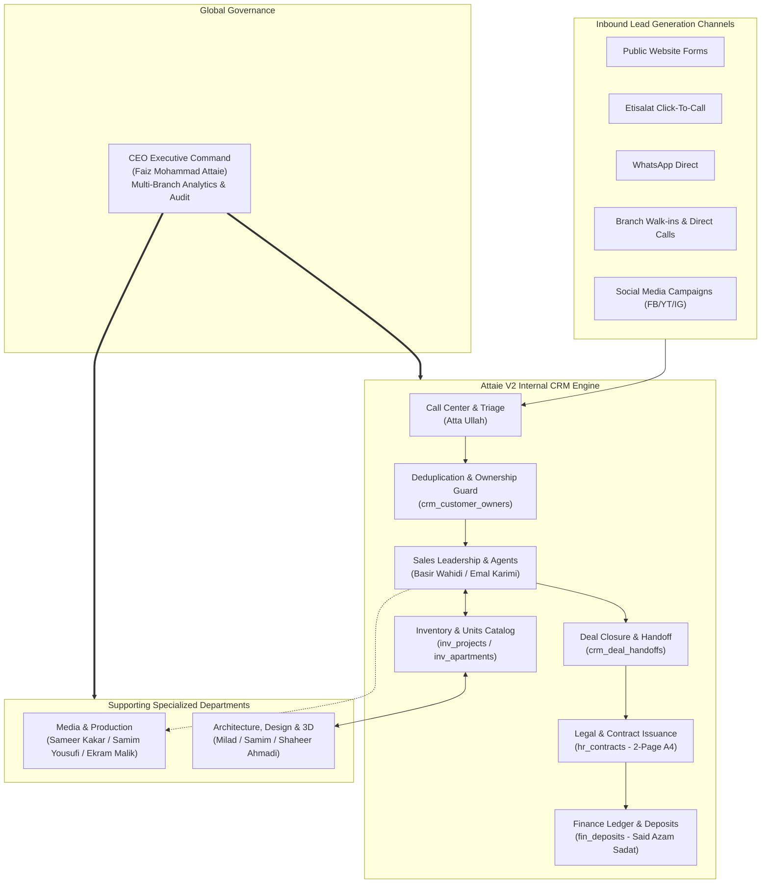
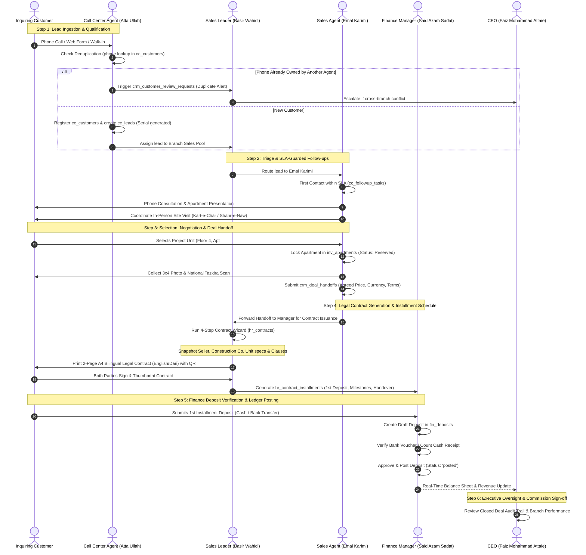
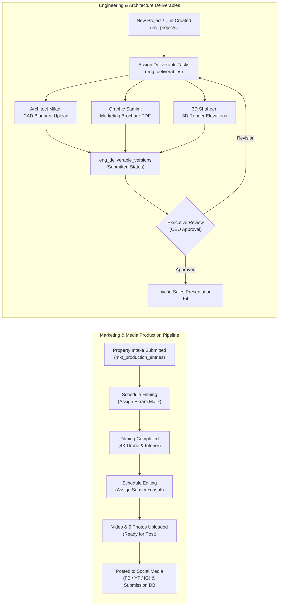
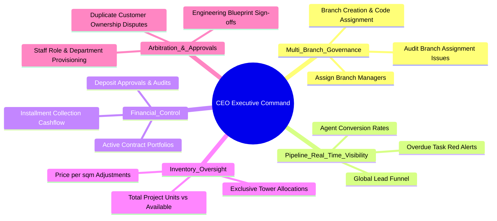

# Attaie Properties V2: End-to-End CRM Workflow & CEO Branch Management Master Guide

This document provides the complete, authoritative operational blueprint for the **Attaie Properties Version 2 Enterprise Real Estate CRM**. It details every stage in the life of a lead—from first customer contact to multi-stage contract issuance and finance deposit clearance—and documents how **Faiz Mohammad Attaie (CEO)** exercises multi-branch executive governance across all departments.

---

## 1. Architectural Overview & System Actors

### The 3-Tier Enterprise Architecture
1. **Public Website (`attaieproperties.com`)**: Static React 19 SPA with multilingual catalog, inquiry forms, WhatsApp integration, and Etisalat CPaaS click-to-call.
2. **Internal Office CRM (`staff-service/` + `/dashboard`, `/callcenter`, `/sales`, `/management`, `/finance`)**: Secure, role-gated backend powered by Firebase Authentication and private PHP 8 sessions.
3. **Isolated Submission Database (`055-submissions-db.sql`)**: Separate database ensuring marketing media submissions and external property postings remain air-gapped from live core financial and customer records.

---

## 2. The 11 Core Actors & Department Structure

| User / Role | Name | Department | Key Responsibility in Deal Lifecycle |
|---|---|---|---|
| **CEO** | **Faiz Mohammad Attaie** | Management | Global oversight across all branches, final dispute arbitration, financial review, engineering approval. |
| **Sales Leader** | **Basir Wahidi** | Sales | Branch lead allocation, SLA deadline tracking, field agent coaching, deal negotiation support. |
| **Sales Agent** | **Emal Karimi** | Sales | Lead qualification, customer visits, property matching, pricing negotiation, deal closure handoff. |
| **Call Center Agent** | **Atta Ullah** | Call Center | 24/7 inbound phone triage, lead registration, customer requirement logging, initial routing. |
| **Finance Manager** | **Said Azam Sadat** | Finance | Installment schedules verification, draft customer deposit entry, receipt approval, ledger posting. |
| **Marketing Manager** | **Sameer Kakar** | Marketing & Media | Inbound campaign oversight, filming schedule management, post-production approvals. |
| **Videographer** | **Ekram Malik** | Marketing & Media | On-site 4K architectural filming, drone exterior footage, interior walkthrough capture. |
| **Video Editor** | **Samim Yousufi** | Marketing & Media | Video grading, Persian/English voiceover synchronization, social media teaser creation. |
| **Architect** | **Milad** | Engineering | CAD blueprint uploads, structural floorplan verification, masterplan zoning deliverables. |
| **Graphic Designer** | **Samim** | Engineering | Marketing brochures, digital PDF catalogs, sales team presentation mockups. |
| **3D Visual Designer** | **Shaheer Ahmadi** | Engineering | Photorealistic 3D apartment renders, virtual interior walkthroughs, lighting elevations. |

---

## 3. End-to-End Lead Lifecycle: Step-by-Step Flow

---

### Step 1: Inbound Lead Initiation & Channel Capture
Leads enter the system through five primary channels:
1. **Public Website Form**: Visitor submits interest on `/properties/:id` or `/contact` with name, phone number, and requirements. Automatically stored in `leads` table and visible to the Call Center.
2. **Etisalat CPaaS Click-to-Call**: Customer enters their phone on the website; the server triggers Etisalat's PBX bridge, ringing Attaie's Call Center first, then dialling the customer.
3. **WhatsApp Direct Gateway**: Quick-launch buttons open WhatsApp pre-filled with the exact property ID and title.
4. **Walk-in Branch Visitors**: Customer walks into a branch office; agent or receptionist logs them directly into the Call Center interface.
5. **Marketing Campaign Inquiries**: Incoming calls from sponsored Facebook, Instagram, or YouTube promotional property videos.

### Step 2: Deduplication Engine & Ownership Protection
To prevent agent friction, commission disputes, and harassment of clients, the CRM executes strict phone deduplication:
- When a phone number is entered, the database queries `cc_customers` and `crm_customer_owners`.
- **Case A: First-time Client**: The system registers a new customer record (`cc_customers`), creates a unique CRM lead serial (`LEAD-2026-XXXXX`), and assigns the creating agent as the customer's permanent owner (`crm_customer_owners`).
- **Case B: Existing Active Customer**: If the phone already exists:
  - The system blocks duplicate creation.
  - The agent can file a **Duplicate Customer Review Request** (`crm_customer_review_requests`).
  - The Sales Leader or CEO reviews the request to either grant **Shared Access** (`crm_customer_shared_access`) or deny the claim with an explanatory note.

### Step 3: Triage, Routing & SLA Follow-Up Tasks
- The Sales Leader (Basir Wahidi) views incoming unassigned draft leads.
- The lead is routed to a specialized Sales Agent (e.g., Emal Karimi) based on language, property type (luxury residential vs. commercial), and geographic branch.
- **SLA Task Generation (`cc_followup_tasks`)**:
  - The system automatically schedules the first mandatory contact window (`deadline_at`).
  - If the agent fails to update the lead before the deadline, the timer logs `late_seconds` and flags the task as **OVERTIME** in bright crimson on the Sales Leader and CEO dashboards.
  - The agent logs detailed call notes and outcomes (`interested`, `follow_up_scheduled`, `meeting_arranged`, `unreachable`, `not_interested`).

### Step 4: Field Visits & Inventory Reservation
- When a customer requests an in-person viewing, the Sales Agent schedules a physical visit.
- The agent utilizes the mobile-optimized **Attaie Sales PWA / Android App** in the field.
- The agent checks live project inventory in `inv_apartments`:
  - Unit status (`available`, `reserved`, `sold`).
  - Technical blueprint, floor number, net square meters, balcony, and orientation.
- Once the customer selects a unit, the agent sets the apartment status to **Reserved**, locking the unit across all branches for a defined window (e.g., 48 hours).

### Step 5: Deal Closure & Handoff Submission
When terms are agreed upon, the Sales Agent creates a formal **Deal Handoff** (`crm_deal_handoffs`):
- Customer legal name and phone.
- Project ID and Apartment ID.
- Final agreed sale amount and currency (`USD` or `AFN`).
- Digital upload of mandatory KYC documents:
  - **Buyer 3x4 formal photograph** (`buyer_photo_url`).
  - **Original Afghan National ID (Tazkira) scan** (`tazkira_photo_url`).
- Handoff status switches to `pending_contract`, triggering notifications to Management and Legal.

### Step 6: 4-Step Legal Contract Issuance (Two-Page A4 Legal Document)
The Manager or Legal Officer opens the contract preparation wizard (`hr_contracts`):
1. **Step 1 - Parties Snapshot**: Automatically pulls immutable legal snapshots of:
   - Landowners & Multiple Sellers (`sellers_snapshot_json`).
   - Construction Company registration details (`construction_snapshot_json`).
   - Buyer Tazkira and residential address details (`hr_contract_buyers`).
2. **Step 2 - Apartment Technical Specifications**:
   - Building name, floor level, apartment number, gross & net area (m²).
   - Agreed price per square meter and total contract consideration.
3. **Step 3 - Dual Calendar Dates & Legal Clauses**:
   - Gregorian Date (e.g., `2026-11-18`) and official Afghan Solar Hijri (Jalali) date (e.g., `1405-08-28`).
   - Standard protective clauses regarding construction delivery milestones, structural guarantees, and default remedies.
4. **Step 4 - Legal Printout Generation**:
   - Generates the standard **Two-Page A4 Bilingual Legal Contract** (English & Dari-Farsi side-by-side).
   - Embeds high-resolution buyer 3x4 photo and Tazkira scan.
   - Includes unique cryptographic verification QR code (`verification_token`) for anti-forgery validation.
   - Formal signing ceremony: Buyer and Attaie Properties authorized signatory affix signatures and official ink thumbprints.

### Step 7: Milestone Installment Schedule Generation
Simultaneously with contract creation, the system generates the scheduled payment milestones (`hr_contract_installments`):
- **Installment 1**: Initial Signing Deposit (e.g., 20% due on contract execution).
- **Installment 2**: Structural Concrete Completion (e.g., 20%).
- **Installment 3**: Facade & Interior Plaster Completion (e.g., 20%).
- **Installment 4**: MEP & Finishing Fixtures (e.g., 20%).
- **Installment 5**: Final Key Handover & Deed Transfer (e.g., 20%).

### Step 8: Finance Deposit Clearance & Ledger Posting
The Finance Manager (Said Azam Sadat) manages the financial ledger (`fin_deposits`):
1. Buyer submits payment via Cash, Bank Wire Transfer, or Bank Cheque.
2. Finance creates a `draft` deposit entry linking the transaction to the specific contract installment.
3. Finance inputs the physical receipt voucher number and uploads the bank slip.
4. After verifying account credit, Finance marks the deposit as **`posted`**.
5. The installment record automatically updates `paid_amount` and recalculates remaining balance.
6. The transaction is permanently locked into the core accounting ledger with an unalterable audit log (`core_audit_log`).

---

## 4. Supporting Departmental Workflows

### Marketing & Media Production Workflow
Managed via `mkt_production_entries` across 6 distinct stages:
1. **Submitted**: A sales agent or call center operator submits an exclusive property listing for media production.
2. **Filming Scheduled**: Marketing Manager Sameer Kakar assigns Videographer Ekram Malik with an on-site filming date.
3. **Filming Completed**: Videographer completes the shoot and marks footage captured.
4. **Editing Scheduled**: Assigned to Video Editor Samim Yousufi with a hard deadline and format specifications (Reel, YouTube Showcase, Cinema Ad).
5. **Ready for Post**: Editor uploads final graded media and a minimum of 5 verified professional high-resolution photos.
6. **Posted**: Content is broadcast across social channels (Facebook, YouTube, Instagram) and pushed to the isolated Submissions Database for website publication consideration.

### Engineering, Architectural & 3D Deliverables
Managed via `eng_deliverables` and `eng_deliverable_versions`:
- **Architect Milad**: Generates and uploads technical CAD blueprints, structural calculations, and building layouts.
- **Graphic Designer Samim**: Designs printable sales dossiers, luxury project catalogs, and customer pitch booklets.
- **3D Visual Designer Shaheer Ahmadi**: Produces photorealistic interior lighting renderings, 3D floorplan cutouts, and panoramic exterior views.
- **Version Control**: Every deliverable preserves full revision history (`version_number`, `file_url`, `notes`, `submitted_at`).
- **CEO Final Review**: Only CEO Faiz Mohammad Attaie holds the permission (`engineering.deliverables.review`) to approve or reject engineering deliverables before they are released to client presentation tablets.

---

## 5. CEO Cross-Branch Management & Executive Command

**Faiz Mohammad Attaie (CEO)** operates from the `/ceo` Executive Command Workspace with unrestricted visibility and authority across all branches.

### 1. Multi-Branch Governance & Branch Assignment
- Unlike branch-scoped agents whose queries are strictly filtered by `WHERE branch_id = :user_branch`, the CEO interface queries across the entire company portfolio.
- **Branch Management**: CEO provisions new branches (`core_branches`) with unique alphanumeric codes, physical office addresses, official contact emails, and dedicated phone lines.
- **Manager Assignment (`core_branch_managers`)**: CEO designates Branch Managers with clear jurisdictional boundaries.
- **Branch Assignment Issues (`core_branch_assignment_issues`)**: Any orphan records (leads, projects, or tasks created without explicit branch attribution) appear in a prioritized resolution queue on the CEO dashboard.

### 2. Live Funnel & SLA Enforcement Radar
The CEO dashboard features interactive real-time visual monitoring tools:
- **Lead Conversion Funnel Chart**: Tracks lead flow across stages: `Draft` $\to$ `Active Follow-up` $\to$ `Site Visit` $\to$ `Deal Handoff` $\to$ `Contract Issued` $\to$ `Deposit Cleared`.
- **Agent Conversion Radar**: Compares performance metrics between agents (e.g., Basir Wahidi's team vs. other regional units) by calculating conversion ratios, total closed dollar volume, and average closing velocity.
- **Overtime & Bottleneck Alerts**: Instantly highlights agents with overdue follow-ups, enabling executive intervention before customer relationships cool.

### 3. Financial & Revenue Oversight
- **Real-Time Cashflow Monitor**: Aggregates all contract amounts, pending receivables, and posted deposits across currencies (`USD` and `AFN`).
- **Installment Ledger Inspection**: Ability to drill down into any customer's payment history, view bank transaction vouchers, and confirm that financial deposits reconcile exactly with physical cashier accounts.

### 4. Dispute Resolution & Customer Ownership Arbitration
When two agents in different branches encounter the same high-net-worth investor, the CEO dashboard acts as the supreme arbitration court:
- Displays full contact chronology, call logs, and timestamped activity records for both agents.
- Allows the CEO to assign exclusive ownership, mandate a shared commission arrangement (`crm_customer_shared_access`), or reassign the client to a senior executive.

### 5. Enterprise Security & Audit Log
- Every sensitive action across the entire CRM—from status changes, price overrides, and contract cancellations to user logins—is recorded in `core_audit_log` with user ID, IP address, timestamp, and payload diffs.
- The CEO has read-only access to this tamper-evident ledger.

---

## 6. Comprehensive CRM Activity Coverage Matrix

| Business Activity | Database Table(s) | Authorized Roles | Automated Trigger / Outcome |
|---|---|---|---|
| **Inbound Call Registration** | `cc_calls`, `cc_leads` | Call Center, Sales | Generates unique lead serial number; starts SLA timer. |
| **Customer Deduplication** | `cc_customers`, `crm_customer_owners` | Call Center, Sales, CEO | Prevents lead stealing; enforces ownership rules. |
| **Duplicate Claim Appeal** | `crm_customer_review_requests` | Sales, Sales Leader, CEO | Formal dispute ticket with manager approval workflow. |
| **Follow-up SLA Scheduling** | `cc_followup_tasks` | Sales, Sales Leader | Tracks on-time vs. overtime task completion in seconds. |
| **Client Activity Logging** | `cc_lead_activities` | All Staff Roles | Permanent history of calls, meetings, notes, and visits. |
| **Apartment Inventory Locking** | `inv_apartments` | Sales, Manager, CEO | Changes status to 'reserved', preventing double-selling. |
| **Deal Handoff Creation** | `crm_deal_handoffs` | Sales Agent, Sales Leader | Uploads buyer photo and Tazkira scan; alerts Legal. |
| **Bilingual Contract Issuance** | `hr_contracts`, `hr_contract_buyers` | Manager, CEO | Produces two-page A4 legal printout with verification QR. |
| **Installment Schedule Plan** | `hr_contract_installments` | Manager, Finance, CEO | Generates automated payment milestone schedule. |
| **Deposit Draft Entry** | `fin_deposits` | Finance Manager | Logs cashier receipt, bank slip, and payment method. |
| **Deposit Approval & Posting** | `fin_deposits` | Finance Manager, CEO | Updates paid balance; locks transaction permanently. |
| **Media Filming Assignment** | `mkt_production_entries` | Marketing Manager | Assigns videographer with target filming date. |
| **Video Production Delivery** | `mkt_production_entries` | Video Editor, Marketing | Mandates 5 photos + edited video before posting. |
| **Engineering Task Assign** | `eng_deliverables` | CEO, Manager | Assigns blueprints, brochures, or 3D renders. |
| **Deliverable Version Upload** | `eng_deliverable_versions` | Architect, Graphic, 3D | Uploads versioned CAD, PDF, or 3D render files. |
| **Engineering Approval** | `eng_deliverable_versions` | CEO | Executive sign-off enabling files in sales apps. |
| **Branch Governance** | `core_branches`, `core_branch_managers` | CEO | Multi-branch provisioning and manager allocation. |
| **Staff User Provisioning** | `core_users`, `core_role_permissions` | CEO | Firebase UID mapping and department authorization. |

---

## 7. Summary of Executive Governance

The Attaie Properties Version 2 CRM replaces informal communication with a **unified, transparent, and auditable digital engine**:
1. **No Lost Leads**: Inbound inquiries are automatically captured, timestamped, and bound by strict SLA deadlines.
2. **Zero Internal Friction**: Customer ownership deduplication eliminates overlapping claims between sales agents.
3. **Legal Rigor**: Contracts are standardized, bilingual, backed by immutable snapshots, and verified via cryptographic QR tokens.
4. **Financial Accuracy**: Every Afghani and Dollar received is validated through draft-to-approval accounting controls.
5. **Total CEO Command**: Faiz Mohammad Attaie maintains continuous, unobstructed visibility over every branch, project, and employee from a single executive dashboard.
